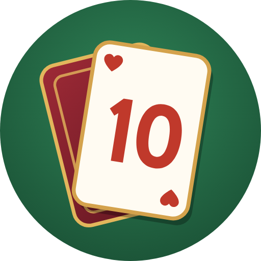

<p align="center"></p>

# Manille

**Manille on your phone**, against bots that play it properly. Everything runs
on the device -- the rules engine, the bots and their networks -- so there is
no account, no server and no connection needed.

### [Download Manille.apk](https://github.com/frigoow/manil-bot/releases/latest/download/Manille.apk)

Android 8.0 or newer, about 330 MB (almost all of it the bots' networks).
Older versions are on the [releases page](https://github.com/frigoow/manil-bot/releases).

To install: open the downloaded file on your phone and allow your browser or
file manager to install unknown apps when Android asks. New versions install
over the old one and keep your profiles, statistics and saved game.

### On a computer: [Windows](https://github.com/frigoow/manil-bot/releases/latest/download/Manille-Windows.msi) · [macOS](https://github.com/frigoow/manil-bot/releases/latest/download/Manille-macOS.dmg) · [Linux (.deb)](https://github.com/frigoow/manil-bot/releases/latest/download/Manille-Linux.deb)

The same game, bots and settings. macOS needs an Apple Silicon Mac (M1 or
later). The packages are not signed: Windows may show a SmartScreen warning
(*More info* > *Run anyway*), and on macOS open the app the first time with
right-click > *Open*.

---

## What's in it

- **Matches to 101** with the real calls -- trump or *mull* (no trump, ×2),
  *kloppen* (knock, ×2) and *terugkloppen* (knock back, ×2) -- or quick single
  deals.
- **Dutch or English**, Dutch by default, with the game's own words.
- **Hints**: the bot's own analysis of your position -- every legal card with
  how much it likes it -- and the same for declarations and knocks.
- **Bot thinking**: by default *Whole deal* (the learned fast policy plays out
  every simulated deal across up to 4 cores); *Standard* (rule play-out) and
  1, 2 or 3 tricks remain selectable, with the measured thinking time shown
  next to the setting.
- The **last trick**, **statistics** per profile, a saved game you can resume,
  six table themes, and bots that react to the game -- including a partner who
  lets you know when you threw away a ten.

---

## The game

Manille is played by four players in two partnerships with a 32-card deck.
The card ranking is unusual: **the 10 (the *manille*) is the highest card**,
above the Ace.

| Card | 10 | A | K | Q | J | 9 | 8 | 7 |
|---|---|---|---|---|---|---|---|---|
| Points | 5 | 4 | 3 | 2 | 1 | 0 | 0 | 0 |

60 points are in play per deal. You must follow suit; if you cannot, you must
trump if able, and you must overtrump if able. The dealer's team chooses trump
or **mull** (no trump, ×2); the other team may **knock** (*kloppen*, ×2), and
the dealer's team may **knock back** (*terugkloppen*, ×2). A deal scores
`(winner's points − 30) × multiplier`, so 30–30 scores nothing. First team to
101 wins the match.

---

## How the bots play

Every move, for whichever bot is to play:

1. **Track** what is public: the cards played, who showed out of which suit,
   the calls.
2. **Sample worlds**: 400 deals of the hidden cards consistent with everything
   seen so far on *Standard* (1600 when the fast play-out net is enabled, or
   exact enumeration late in the deal when all consistent worlds fit). Each is
   weighted by a **belief network** (which seat holds which unseen card) and by
   play-history likelihood (the fast net's honest card probabilities on trump
   deals, rule-policy mismatches otherwise). After a knock, worlds are
   reweighted by how likely each hand was to make that call, then deduplicated
   and stratified-resampled before play-out.
3. **Rule tiers** propose a card: cash winners, keep the partner's trick, don't
   feed the opponents' trick, lead the suit that develops tricks -- with a
   separate rule set for no-trump play.
4. **Play-out**: across up to 4 CPU cores in parallel, each world is played to
   the end of the deal by a fast rule or learned policy (with two-stage
   candidate racing pruning clearly dominated moves after 192 worlds, or solved
   exactly by double-dummy alpha-beta in the last 4 tricks of a mull deal),
   giving the expected final score of every card.
5. **Blend** each card's play-out value with a learned **Q-network** (60/40,
   tapering to 85/15 late in a trump deal and in the exact mull endgame), and
   overrule the tiers' proposal only when the paired evidence across worlds
   clears a z-test.

Sampling, knock weighting and play-out take about 7 ms/move on *Standard*
(1.4 ms on undoubled deals) and 42 ms/move on *Whole deal* (17 ms undoubled) on
a desktop CPU -- well under a tenth of a second even on *Whole deal* with 1600
worlds.

The calls -- trump or mull, knock, knock back -- come from a separate
**decision layer**. It plays for the *match*, not for the points of one deal:
a margin network predicts how the deal will end for each option, and each
outcome is scored by the exact probability of winning the match from the
resulting score. The same hand mulls at 50–90 behind and plays safe at 90–50
ahead.

The trump/mull choice comes from a version of the decision layer refit to
these bots' own deals; the knocks from the original. On the 5000 deals of
22,000 where the two disagreed, the refit chose trump as well (match
equity −0.04 pp, and +1.4 points per deal) but knocked worse (−2.2 pp).

### How strong

Points per deal, from duplicate deals -- every deal replayed with the teams
swapped, so the comparison is how two players handled *the same cards*:

| The phone bot against | Points per deal (95% CI) |
|---|---|
| ISMCTS-5000, the classic search baseline | **+2.29** (4000 deals) |
| A DMC self-play network playing on its own | **+1.7** (4000 deals) |
| The same network, with real declarations and knocks (as in the app) | **+1.43** [+1.18, +1.67] (3000 deals) |
| SPARTA, a GPU search over that network | +0.14 [−0.22, +0.50] -- level (1200 deals) |

**Against SPARTA, version 1.0.4** (500 deals of each kind; the declarations
and knocks as in the app; "with knocks" counts the doubled scores):

| Bot thinking | Trump deals | with knocks | Mull deals | with knocks |
|---|---|---|---|---|
| Standard (the default) | +0.31 [−0.25, +0.87] | +0.33 [−0.17, +0.84] | +0.27 [−0.58, +1.12] | +0.42 [−0.48, +1.33] |
| Whole deal | **+0.81** [+0.23, +1.40] | +0.28 [−0.17, +0.74] | **+1.07** [+0.24, +1.90] | **+1.13** [+0.21, +2.06] |

Level by default; on *Whole deal* the phone bot beats the strongest search
player of the research project, clearly on mull deals and on trump-deal
points (the trump result with the knocked deals' doubling counted is not yet
significant).

What the *Bot thinking* setting buys over *Standard*, each on 3000 deals
against the network: *Whole deal* +0.37 on trump deals, +0.36 on mull deals;
*2 tricks* about +0.75 on mull deals. Version 1.0.4's changes, on the same
kind of test: the no-trump play-out (cash the team's sure winners, cross to
the partner's) +0.49 and +0.51 on two separate sets of mull deals; the
defenders' trump leads from weak holdings fell from about 25 to 2 per 150
trump deals at no measurable cost (+0.09 [−0.14, +0.32]).

**Latest rule-agent improvements against the shipped 36M Q-GRU network** (1000
trump deals and 1000 mull deals, duplicate, with real declarations and knocks;
1-core time measures sampling + knock weighting + play-out on a desktop core):

| Bot thinking | Trump deals | with knocks | Mull deals | with knocks | 1-core time |
|---|---|---|---|---|---|
| v1.1.2 Standard | +1.45 [+1.07, +1.82] | +1.00 [+0.72, +1.28] | +1.54 [+1.02, +2.06] | +1.68 [+1.12, +2.23] | ~26 ms |
| v1.1.2 Whole deal | +1.54 [+1.17, +1.90] | +1.26 [+0.96, +1.57] | +1.14 [+0.66, +1.63] | +1.15 [+0.63, +1.67] | ~490 ms |
| Standard (400 worlds) | +1.30 [+0.92, +1.68] | +0.94 [+0.65, +1.22] | +1.71 [+1.19, +2.24] | +1.77 [+1.22, +2.32] | 7.9 ms |
| 2 tricks (800 worlds) | +1.87 [+1.50, +2.24] | +1.31 [+1.01, +1.61] | **+1.76** [+1.28, +2.24] | **+1.89** [+1.34, +2.44] | 35.6 ms |
| **Whole deal** (800 worlds) | **+2.13** [+1.76, +2.50] | **+1.60** [+1.30, +1.91] | **+1.75** [+1.27, +2.24] | **+1.88** [+1.37, +2.38] | 50.2 ms |

On paired deals, the new *Whole deal* beats v1.1.2 *Whole deal* by **+0.59**
[+0.19, +0.99] on trump deals (+0.34 [+0.01, +0.67] with knocks) and **+0.61**
[+0.10, +1.12] on mull deals (+0.72 [+0.17, +1.27] with knocks) while running
roughly 10× faster, and beats v1.1.2 *Standard* by **+0.68** [+0.24, +1.12] on
trump deals (+0.61 [+0.25, +0.96] with knocks). Defenders' trump leads from weak
holdings stay low (~3.9 per 150 trump deals).

How to rerun these matches: [research/README.md](research/README.md).

A deal splits 60 card points, so a point or two per deal is a large edge. The
bots have never been formally measured against people.

---

## Build it yourself

Needs the Android SDK with platform 37, NDK 30.0.16138531 and CMake 3.22.1
(Android Studio installs them) and a JDK 17+.

```bash
git clone https://github.com/frigoow/manil-bot.git && cd manil-bot
scripts/fetch_models.sh                 # the networks, into android/app/src/main/assets/models
cd android && ./build.sh assembleDebug  # -> app/build/outputs/apk/debug/app-debug.apk
```

`build.sh` uses Android Studio's bundled JDK on common Linux paths; set
`JAVA_HOME` to use another. The C++ can also be built and tested on a desktop,
no phone needed:

```bash
cmake -B build -S cpp -DCMAKE_BUILD_TYPE=Release && cmake --build build -j
ctest --test-dir build
```

**Your own names.** The bots are called Jef, Mieke, Staf and friends. To give
them other names in your own builds, put this in `~/.gradle/gradle.properties`
(it never enters the repository):

```properties
manille.botNames=Ann,Bob,Cas,Dirk
manille.cafeThemeName=Our café
```

---

## Releases

Pushing a tag `vX.Y.Z` runs `.github/workflows/release.yml`: it fetches the
networks, builds and signs the APK, and publishes it as release `vX.Y.Z`,
which `releases/latest/download/Manille.apk` then points at. It then builds
the desktop packages on Windows, macOS and Linux runners
(`.github/workflows/desktop.yml`) and attaches them to the same release. To
release:

1. bump `versionCode` (+1) and `versionName` in `android/app/build.gradle.kts`,
2. commit, then `git tag vX.Y.Z && git push origin main vX.Y.Z`.

The workflow refuses a tag that does not match `versionName`. Signing uses
four repository secrets: `MANILLE_KEYSTORE_B64` (the keystore, base64),
`MANILLE_KEYSTORE_PASSWORD`, `MANILLE_KEY_ALIAS`, `MANILLE_KEY_PASSWORD`.
Android only installs an update signed with the same key as the installed
app, so that key must never change.

The networks are versioned separately as release `models-v1`
(`manille-app-models.zip`). A new set of networks goes into a new models
release, and `MODELS_TAG` in the workflow and `scripts/fetch_models.sh` moves
to it.

---

## Repository layout

```
android/        the app: Kotlin Multiplatform game and UI (shared/), Android shell (app/)
cpp/            the rules engine, world samplers, rule agent and play-out; ISMCTS
                and the Python module for research/
cpp/mobile/     the plain C interface the app calls through JNI
research/       DMC training, SPARTA, the evaluation harness (research/README.md)
scripts/        fetch_models.sh
third_party/    ismcsolver, header-only ISMCTS (MIT)
```

**The engine is the only rules implementation.** Legality, trick resolution
and scoring live in `cpp/manille_game.cpp`; the UI, the samplers and the bots
all ask it.

The networks were trained by self-play (Deep Monte Carlo: a Q-network trained
on full-episode returns, separate networks for trump and no-trump deals) and
exported to ONNX. The training code, the SPARTA search, the Python reference
of the rule agent (parity-tested card for card against the C++) and the
duplicate-deal harness behind the numbers above are in
[`research/`](research/README.md), with the trained networks as a release
download, so every result can be inspected and reproduced. Code comments that
mention `gui/` refer to the project's desktop GUI, which is not included.

---

## License

Apache 2.0 -- see [LICENSE](LICENSE).

Includes the game interface header of
[ismcsolver](https://github.com/sfranzen/ismcsolver) by Steven Franzen (MIT,
`third_party/ismcsolver`). The app uses
[ONNX Runtime](https://github.com/microsoft/onnxruntime) (MIT) from Maven.
